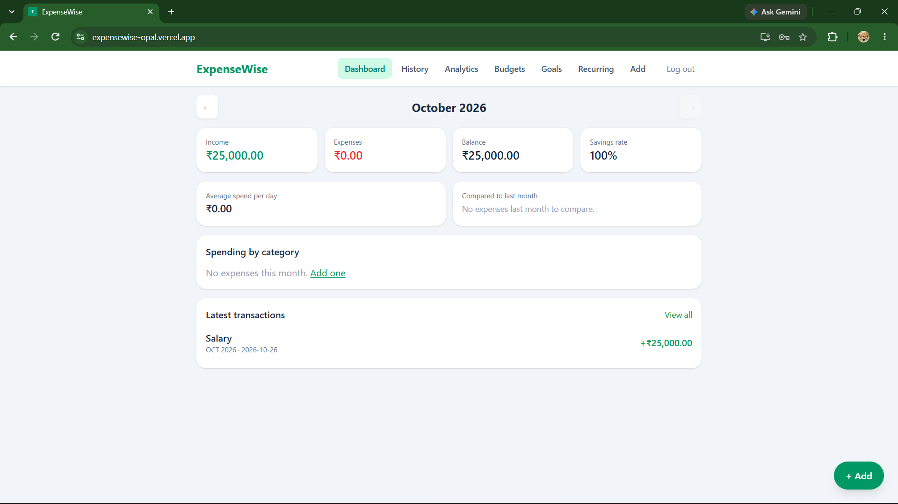
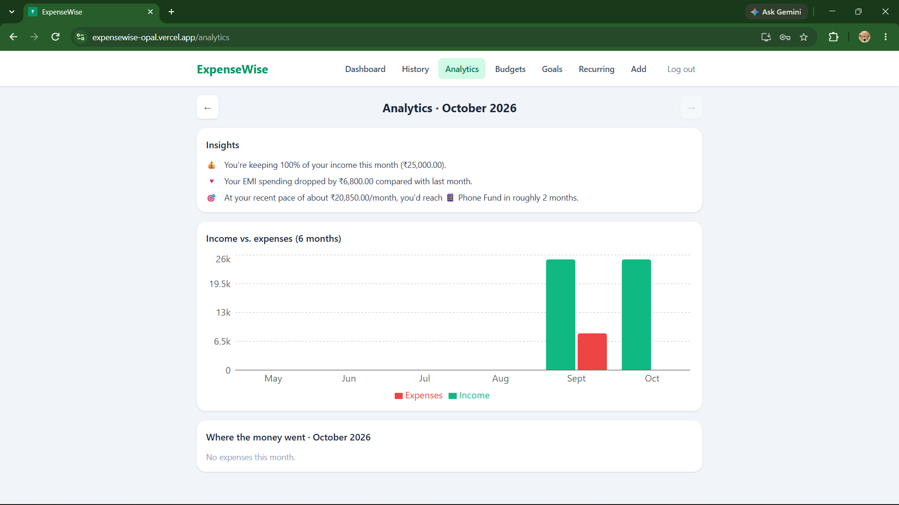
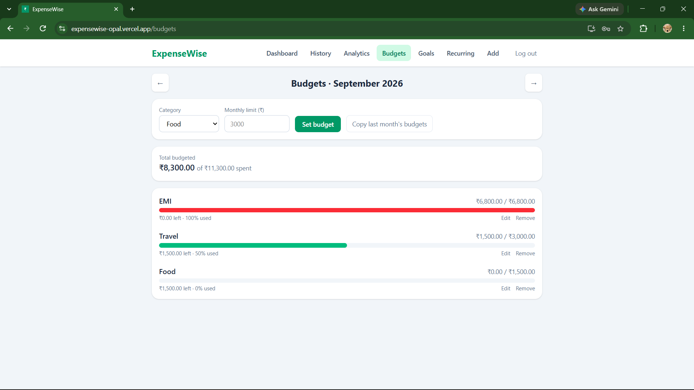
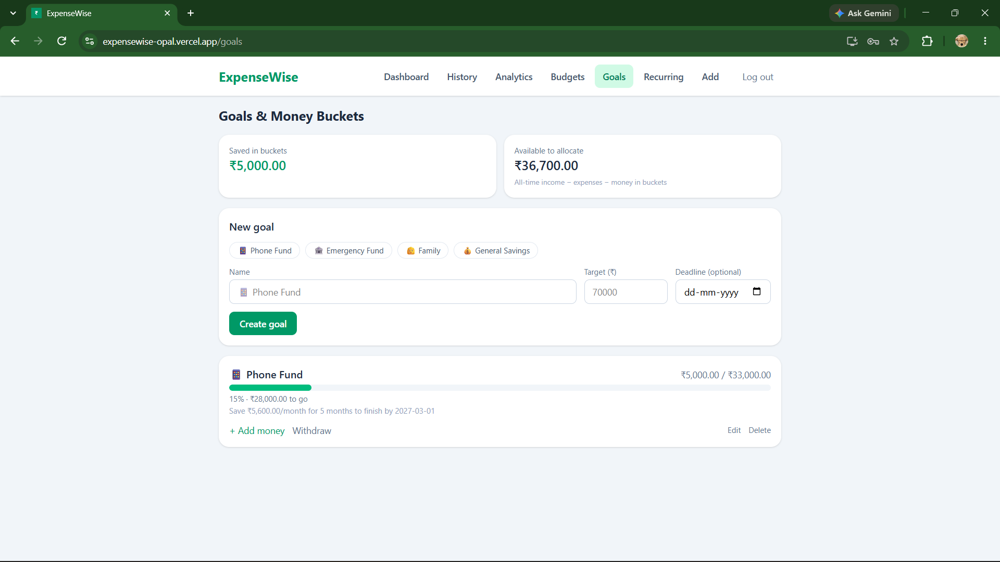
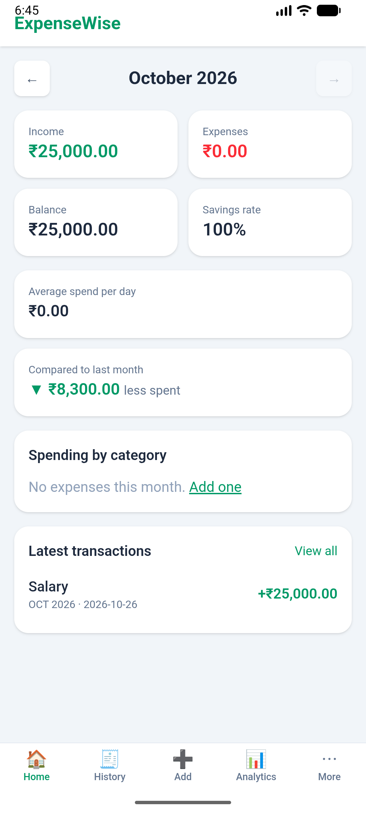

# ExpenseWise

A personal finance tracker for income, expenses, budgets, savings goals and recurring payments, with analytics and insights. One React codebase runs as a **website, an installable PWA, and an Android app**.

**Live demo:**https://expensewise-opal.vercel.app/



## Features

- **Auth and privacy:** email login; Row Level Security so each user only ever sees their own data
- **Transactions:** add, edit, delete; filter by month, type, category and search
- **Dashboard:** monthly income, expenses, balance, savings rate, daily average, month-over-month comparison
- **Budgets:** per-category monthly limits with colour-coded progress, and one-click copy from last month
- **Savings goals ("money buckets"):** deposits, withdrawals, deadlines, and a "save X per month" hint
- **Recurring payments:** EMIs, SIPs, rent and subscriptions with due-date tracking and "Mark as paid", which creates the expense and advances the due date
- **Analytics:** 6-month income vs. expense chart, category breakdown, and rule-based insights (spending changes, biggest category, goal projections)
- **Responsive and installable:** mobile bottom navigation, PWA, Android build via Capacitor

## Screenshots

| Analytics | Budgets | Goals | Mobile |
|---|---|---|---|
|  |  |  |  |

## Tech stack

React 19 · Vite · Tailwind CSS · React Router · Recharts · Supabase (PostgreSQL, Auth, RLS) · Capacitor (Android) · Vercel

## Architecture

```text
React (Vite)  ──►  Supabase JS client  ──►  PostgreSQL + Auth + RLS
     │
     ├── Vercel (web + PWA)
     └── Capacitor (Android APK)
```

## Run locally

```bash
git clone https://github.com/SJK707/expensewise.git
cd expensewise
npm install
cp .env.example .env     # then fill in your Supabase values
npm run dev
```

Create the database by running `supabase/schema.sql` in the Supabase SQL Editor.

## What I learned

- Designing a relational schema and securing it with Row Level Security
- Handling dates and timezones correctly (local dates vs. UTC)
- Building one codebase that targets web, PWA and Android
- Turning raw transactions into insights with aggregation logic

## Roadmap

- Server-side aggregation with SQL views
- CSV import of bank statements
- Custom categories